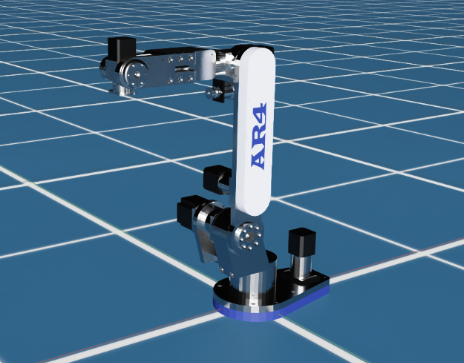

# Description
An Isaac simulation of the AR4 Package, running on Isaac Sim 6.1 and ROS 2 Jazzy.

The simulation runs an OmniGraph that publishes `/clock` and `/joint_states` and subscribes to
`/joint_command` through the Isaac Sim ROS 2 bridge. On the ROS side,
[`topic_based_ros2_control`](https://github.com/PickNikRobotics/topic_based_ros2_control) exposes
those topics to `ros2_control`, so the usual `arm_controller` and MoveIt work against the
simulation.

## Prerequirements

Running the `nvidia` isaac simulation requires:

  - An NVIDIA GPU that meets the [Isaac Sim System Requirements](https://docs.isaacsim.omniverse.nvidia.com/latest/installation/requirements.html)
  - [Installing the NVIDIA Container Toolkit](https://docs.nvidia.com/datacenter/cloud-native/container-toolkit/latest/install-guide.html)

## Run the simulation container

```
docker/run.sh -s ar4_isaac
```

The image is based on `nvcr.io/nvidia/isaac-sim:6.1.0` with ROS 2 Jazzy installed on top.
`topic_based_ros2_control` has no Jazzy release, so it is built from source in the image
(see `docker/files/isaac.repos`).

## Build the packages

Build the packages

```
source /opt/ros/jazzy/setup.bash
colcon build --packages-up-to ar4_isaac
```

Source the built packages

```
source install/setup.bash
```

## Launch the simulation

Isaac Sim, the controllers and MoveIt with RViz:

```
ros2 launch ar4_isaac moveit.launch.py
```

Or only the simulation:

```
ros2 launch ar4_isaac ar4_in_empty_world.launch.py
```

Add `headless:=true` to either launch to run Isaac Sim without its window.

The first start takes a few minutes while Isaac Sim compiles its shaders; they are cached in
`~/docker/isaac-sim/` on the host, so later starts take well under a minute.



## More:

  - [Update the model](docs/UPDATE_MODEL.md)
